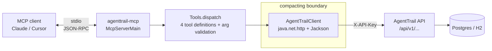

# agenttrail-mcp — MCP server for AgentTrail

A [Model Context Protocol](https://modelcontextprotocol.io) server (stdio transport)
that exposes AgentTrail's recorded agent sessions to AI assistants. Point Claude,
Cursor, or any MCP client at it and ask things like:

- *"What failed in my agent runs today?"*
- *"Replay the last failed session — where exactly did it go wrong?"*
- *"Has this `npm test` failure happened before? Show me the pattern."*
- *"How much did my agent sessions cost this week, and which one was priciest?"*

The server is **read-only**: four tools, all mapped to the AgentTrail v1 API
([`docs/API_CONTRACT.md`](../docs/API_CONTRACT.md)).

| Tool | AgentTrail endpoint | What it answers |
|---|---|---|
| `list_sessions` | `GET /api/v1/sessions` | find runs (filter by agent type, status, text, date range), with per-session stats |
| `get_session_events` | `GET /api/v1/sessions/{id}/events` | replay one session's seq-ordered timeline: tool calls, errors, handoffs, costs |
| `search_events` | fan-out over sessions | free-text search over event summaries/tool names **across** sessions — repeated failure modes |
| `cost_summary` | `GET /api/v1/stats/overview` + session list | totals, cost by day, top-N most expensive sessions |

## Quickstart

Prereqs: Java 21+, Maven 3.9+, and the AgentTrail API running
(`docker compose up` at the repo root → API on `http://localhost:8080`).

```sh
cd mcp
mvn -q package -DskipTests        # builds target/agenttrail-mcp.jar (shaded, all deps)
AGENTTRAIL_BASE_URL=http://localhost:8080 AGENTTRAIL_API_KEY=dev-key \
  java -jar target/agenttrail-mcp.jar
```

Wire it into a client (Claude Desktop, Cursor, …):

```json
{
  "mcpServers": {
    "agenttrail": {
      "command": "java",
      "args": ["-jar", "/absolute/path/to/agenttrail-mcp.jar"],
      "env": {
        "AGENTTRAIL_BASE_URL": "http://localhost:8080",
        "AGENTTRAIL_API_KEY": "dev-key"
      }
    }
  }
}
```

## Demo transcript

With the demo seed loaded (`POST localhost:8080/api/v1/demo/seed`), a real session
through Claude looked like this (abridged):

> **You:** what failed in my agent runs today?
>
> **Claude** → `list_sessions({"status": "failed"})`
> → 1 session: `3f9d…` "Fixed NPE in checkout flow" — 3 errors, 25 tool calls, $1.84
>
> **Claude:** One failed run: "Fixed NPE in checkout flow" (3 errors). Replaying it…
> → `get_session_events({"sessionId": "3f9d…", "type": ["error", "tool_call"]})`
>
> **Claude:** The failure starts at seq 14 — `Bash` ran `npm test` (exit 1, 4.2s),
> then a `NullPointerException in Checkout` error at seq 15. Two more test runs
> failed the same way before the fix landed at seq 31 (`Edit` to `Checkout.java`).
>
> **You:** has this npm test failure happened before?
>
> **Claude** → `search_events({"q": "npm test"})`
> → 6 matching events across 3 sessions this week, same exit-code pattern —
> looks like a flaky test rather than your change.

`cost_summary` answers the money question without any session hunting:
→ `cost_summary({"from": "2026-10-13T00:00:00Z"})`
→ totals, per-day spend, and the 5 most expensive sessions with their summaries.

## Architecture



`AgentTrailClient` returns **compacted JSON** — session/event fields are trimmed to
what an assistant needs for debugging (id, type, seq, ts, summary, duration, cost,
tags). Raw `detail` blobs, `metadata`, and `cwd` are dropped so a session replay
fits the context window. Pagination envelopes keep `totalElements` so the client
knows when to ask for the next page.

## Design trade-offs

- **Java + official `io.modelcontextprotocol.sdk:mcp` instead of the Python SDK.**
  This module's purpose is partly to learn the Java SDK (an OSS contribution
  target), and it keeps the repo's JVM story consistent (server + Java SDK +
  MCP server). The Python SDK would have been ~30% less code, but the whole
  point here is Java-lane depth. The stdio transport works cleanly in the Java
  SDK (`StdioServerTransportProvider`), so there was no forcing reason to switch.
- **Read-only tools.** The write endpoints exist so agents record their own runs;
  a querying assistant has no business appending to someone else's flight
  recorder. Read-only also keeps the tool surface safe to enable by default.
- **`search_events` is client-side fan-out.** The v1 API has no cross-session
  event-search endpoint, so the server lists candidate sessions (bounded,
  default 20) and queries each session's events with `q=`, merging by timestamp.
  It's O(sessions) HTTP calls — honest about the cost, bounded by `maxSessions`
  and `limit`, and the schema says so. A server-side endpoint would be the real
  fix (noted in Limitations).
- **Failures surface as `isError` results, not exceptions.** An unreachable API
  or a 404 returns a readable error string to the assistant instead of killing
  the stdio session — the server stays up for the next question.
- **Fat jar via `maven-shade-plugin`.** One `java -jar` is the friendliest thing
  to put in an MCP client config; no classpath assembly, no wrapper scripts.

## Known limitations

- `search_events` fans out per session (see trade-offs); with hundreds of
  sessions it's slow. A `GET /api/v1/events:search` endpoint on the server would
  fix this properly.
- `cost_summary`'s "top sessions" sorts client-side over up to 200 sessions —
  fine at personal scale, not at hosted scale.
- Event `detail` blobs are intentionally dropped for context-window economy; if
  you need the full output excerpt, use the dashboard or the raw API.
- Read-only by design: no session/event creation tools. Recording still goes
  through the SDKs, hooks, or `run_wrapped.sh`.
- No auth on the MCP side itself — stdio means the OS user boundary is the
  security boundary, which is the standard MCP-local setup. The AgentTrail API
  key stays in the server's environment, never in tool results.

## Tests

12 unit tests, no sockets (the HTTP transport is stubbed by subclassing):

```sh
cd mcp && mvn verify
```

CI (`.github/workflows/mcp.yml`) runs `mvn verify` on every push to `mcp/`.

## License

MIT — see [../LICENSE](../LICENSE).
